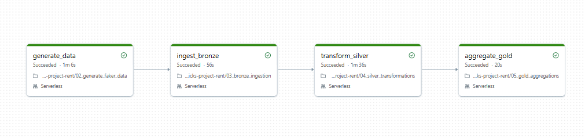

# Ride Lakehouse Project

This project demonstrates a simple end-to-end Lakehouse pipeline in Databricks using Unity Catalog, Delta Lake, Auto Loader, and layered data processing. It follows the classic Bronze → Silver → Gold architecture commonly used for analytics and data engineering workloads.

## Pipeline Overview



The workflow is structured as follows:

1. Generate synthetic ride event data
2. Ingest raw files into the Bronze layer
3. Transform and clean data in the Silver layer
4. Aggregate business metrics in the Gold layer

---

## Project Goals

This repository was designed to practice and demonstrate:

- Lakehouse architecture in Databricks
- Unity Catalog catalog, schema, and volume setup
- Streaming ingestion with Auto Loader
- Data cleaning and standardization in Silver
- Business aggregations in Gold
- Schema evolution handling
- Delta Lake time travel and restore
- Data optimization techniques
- Governance and access control
- Testing and orchestration patterns

---

## Data Architecture

The project creates a Databricks catalog named `ride_lakehouse_dev` with three main schemas:

```text
ride_lakehouse_dev
├── bronze
├── silver
└── gold
```

### Layers

- Bronze: raw, minimally processed data stored from incoming JSON files
- Silver: cleaned, deduplicated, validated business data
- Gold: curated analytical tables and aggregated KPIs

Example entity types include:

- drivers
- rides
- payments
- driver_stats
- daily_stats

---

## Notebook Flow

The project is organized into these notebook stages:

- `01_setup_lakehouse.ipynb` — create catalog, schemas, and volumes
- `02_generate_faker_data.ipynb` — generate fake ride and payment data
- `03_bronze_ingestion.ipynb` — ingest raw files into Bronze tables
- `04_silver_transformations.ipynb` — clean and transform Bronze data into Silver tables
- `05_gold_aggregations.ipynb` — build Gold analytics and aggregated views
- `06_schema_evolution.ipynb` — test and manage schema changes over time
- `07_time_travel_restore.ipynb` — restore previous versions of Delta tables
- `08_optimization.ipynb` — optimize table storage and performance
- `09_governance.ipynb` — configure data access and governance patterns
- `10_sql_examples.ipynb` — sample SQL queries for analytics
- `11_tests.ipynb` — validate tables, pipeline behavior, and data quality
- `12_job_orchestration.ipynb` — orchestrate the workflow as jobs

---

## Environment Requirements

To run this project, you will need:

- A Databricks workspace
- Unity Catalog enabled
- A compute cluster with Spark and Delta support
- Permissions to create catalogs, schemas, volumes, and tables

---

## Typical Execution Order

1. Run `01_setup_lakehouse.ipynb`
2. Run `02_generate_faker_data.ipynb`
3. Run `03_bronze_ingestion.ipynb`
4. Run `04_silver_transformations.ipynb`
5. Run `05_gold_aggregations.ipynb`
6. Run `06_schema_evolution.ipynb`
7. Run `07_time_travel_restore.ipynb`
8. Run `08_optimization.ipynb`
9. Run `09_governance.ipynb`
10. Run `11_tests.ipynb`
11. Use `12_job_orchestration.ipynb` for job scheduling and automation

---

## Business Use Case

This demo simulates a rideshare or mobility platform where data is generated continuously across multiple domains:

- drivers
- rides
- payments
- daily performance metrics

The outcome is a practical example of how ingestion, transformation, governance, and analytics can work together in a modern Lakehouse environment.

---

## Notes

This project is intended as a learning and practice repository. It is especially useful for understanding how data engineering workflows are implemented in Databricks and how Delta tables can be managed across raw, cleaned, and curated layers.
